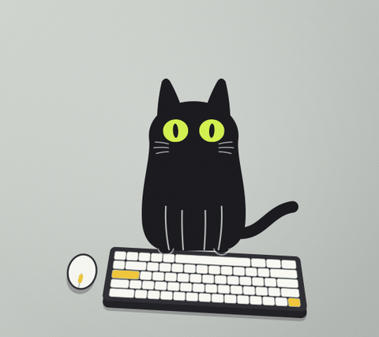
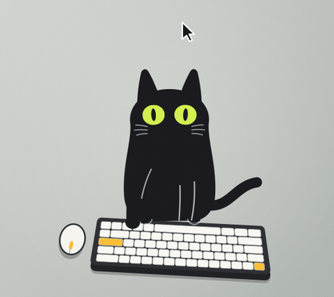
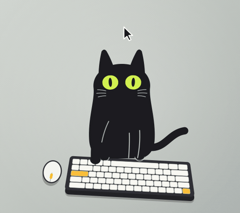
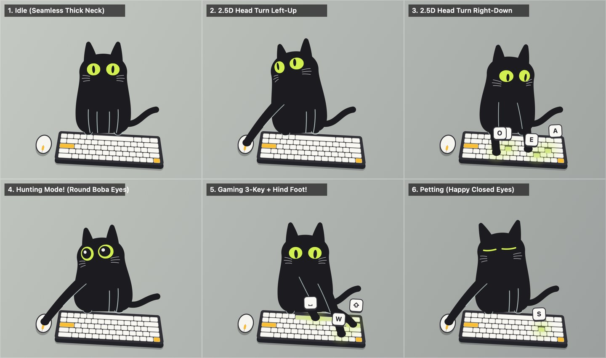
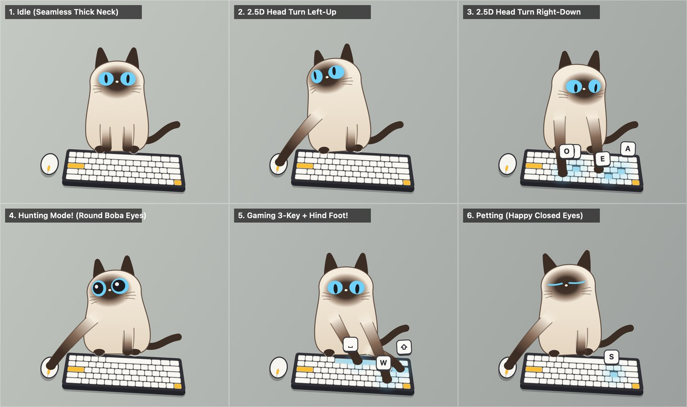

# 🐱 KuroCat — 全状态键盘鼠标桌面萌猫 (macOS / Windows / Linux / 统信 UOS)

<p align="center">
  
  
  
</p>

<p align="center">
  <b>超轻量级原生桌面宠物 · 打字 & 玩游戏全状态硬件级监听 · 2.5D 球面转头 · 捕猎大圆眼 · 双皮肤自由切换</b><br/>
  Native macOS (Swift + CoreGraphics + IOHIDManager) · Windows (C++17 + GDI+ + Raw Input) · Linux / 统信 UOS (C++17 + GTK3/Cairo + XInput2/evdev)
</p>

---

## ✨ 特性亮点

- **🎮 打字 & 玩游戏全状态接收（真正全键无冲 NKRO）**
  - **macOS**：双层架构 `IOHIDManager`（内核 HID 硬件层）+ `CGEventTap`，不受中英文输入法干扰，完整支持游戏里长按 `WASD`、组合快捷键、单独修饰键（`⌘ / ⇧ / ⌥ / ⌃ / Fn`）、方向键与 `F1–F12`。
  - **Windows**：原生 `Raw Input API (RIDEV_INPUTSINK)` 硬件扫描码监听，打字与 DirectX/Vulkan 游戏内按键、鼠标锁定微动均可全局捕获。
  - **Linux & 统信 UOS**：双层 `XInput2 (XI_RawKeyPress/Motion)` + 内核 `evdev (/dev/input/event*)`，**在统信 UOS / Deepin / Ubuntu X11 桌面下双击即用、免 sudo 即可全局监听打字与游戏按键**；Wayland 下加入 `input` 组即可开启硬件级全状态监听。
- **🌀 2.5D 球面转头 & 真实面向视角**
  - 采用 Live2D 同款球面投影算法，猫头、双耳、双眼与胡须随鼠标光标产生真实的 2.5D 透视转头与视差；键盘与鼠标 180° 朝向小猫摆放，玩游戏时左手键盘、右手鼠标自然不交叉。
- **⚡ 捕猎大圆眼模式**
  - 快速晃动鼠标时，小猫瞳孔从竖瞳逐渐扩张为超大圆润黑瞳 + 白色高光，身子压低伏击、尾巴加快抽动、全程锁敌不眨眼。
- **🐾 丰富交互彩蛋**
  - **3 键同时按「用脚按」**：同时按住 3 个及以上按键时，小猫会翘起后脚踩上第 3 个键！
  - **摸头/摸背互动**：鼠标轻撸猫头会露出惬意闭眼 `— —` 与微光粒子，闲置久了还会打瞌睡冒 `z`。
  - **智能鼠标穿透 & 开机自动启动**：透明区域自动穿透不挡操作；玩竞技游戏时可一键开启「完全鼠标穿透（游戏防误触）」，支持一键勾选「开机自动启动」（Windows 注册表 / macOS LaunchAgent / Linux XDG Autostart）。
- **🎨 双皮肤 & 多配色自由搭配**
  - **猫咪皮肤**：经典小黑猫（原版荧光黄绿瞳）/ 挖煤暹罗猫（暖燕麦奶白 + 2.5D 焦糖面罩 + 巧克力小袜子 + 宝石蓝瞳）
  - **键盘配色**：经典奶白暖黄 / 暗夜极客黑 / 复古奶油灰
  - **瞳色与缩放**：4 种瞳色、5 档尺寸缩放、今日击键与实时 KPM 统计。

### 双皮肤 6 态预览

| 经典小黑猫 | 挖煤暹罗猫 |
| :---: | :---: |
|  |  |

---

## 📦 下载与运行

前往右侧 **[Releases](../../releases)** 页面直接下载对应系统版本（由 GitHub Actions 自动编译）：

### 🍎 macOS (Apple Silicon & Intel 通用 · macOS 13+)
1. 下载 `KuroCat-macOS-universal.zip` 解压，将 `KuroCat.app` 拖入「应用程序」打开（常驻顶部菜单栏，不占 Dock）。
2. 首次使用点击小猫底部提示胶囊，前往 **系统设置 → 隐私与安全性 → 输入监控** 勾选 `KuroCat` 后在菜单栏点「重启 KuroCat」即可全局监听打字与游戏按键。
3. 支持在菜单中一键开启 **开机自动启动**；开启「完全鼠标穿透」后，可通过顶部菜单栏小猫图标或 **按住 `⌥ Option` 键直接右键/拖动小猫**。

**本地源码编译：**
```bash
chmod +x build.sh
./build.sh
open KuroCat.app
```

### 🪟 Windows (Windows 10 / 11 x64)
1. 下载单文件 `KuroCat-Windows-x64.exe`（约 220 KB，**零外部运行时依赖**），双击即可运行，常驻右下角系统托盘。
2. 右键小猫或左键/右键托盘小猫图标即可切换皮肤、键盘配色、尺寸、**开机自动启动**、游戏防误触穿透模式等。
3. **开启「完全鼠标穿透」后，以下 4 种方式均可随时取消或呼出菜单**：
   - 全局快捷键：**`Ctrl + Alt + Shift + P`** 一键切换/取消穿透；
   - 临时解锁：按住 **`Alt`** 键，再直接右键小猫取消勾选或左键拖动；
   - 系统托盘：点击任务栏右下角 **`^` 隐藏图标区** 中的黑猫图标（左键或右键均可弹出菜单）；
   - 保底方式：**再次双击 `KuroCat.exe`**，会自动取消穿透并直接在鼠标处弹出设置菜单。
   > 若部分网游以管理员权限运行，右键「以管理员身份运行」`KuroCat.exe` 即可同步捕获游戏内按键。

**本地源码编译（MSVC / MinGW）：**
```bat
cd windows
build.bat
```
或使用 CMake：
```bat
cd windows
cmake -B build && cmake --build build --config Release
```

### 🐧 Linux & 统信 UOS / 银河麒麟 (x86_64 & ARM64)
支持 **Ubuntu 20.04+ / Debian 11+ / Deepin / 统信 UOS（x86_64 & ARM64 飞腾/鲲鹏）/ 银河麒麟 / Arch / Fedora**：

1. **统信 UOS / Deepin / Ubuntu / Debian（推荐直接装 `.deb`）**：
   - 下载对应架构安装包：`KuroCat-Linux-amd64.deb`（Intel/AMD/兆芯/海光）或 `KuroCat-Linux-arm64.deb`（飞腾/鲲鹏/树莓派等 ARM64）。
   - 统信 UOS 直接**双击 `.deb` 用软件包安装器安装**，或终端执行：
     ```bash
     sudo apt install ./KuroCat-Linux-amd64.deb
     ```
   - 安装后在开始菜单搜索 **KuroCat** 或终端输入 `kurocat` 启动。**统信 UOS 默认 X11 桌面开箱即用，无需额外权限即可全局监听打字和游戏！**
2. **其他 Linux 发行版（Arch / Fedora 等）**：
   - 下载 `KuroCat-Linux-x86_64.tar.gz` 或 `KuroCat-Linux-arm64.tar.gz` 解压直接运行 `./kurocat`。
   - 若使用纯 **Wayland** 会话，执行一次 `sudo usermod -aG input $USER` 并重新登录即可启用 `evdev` 内核级全局监听。
3. **龙芯（LoongArch）或老版本 UOS 本地源码编译**：
   ```bash
   sudo apt install g++ pkg-config libgtk-3-dev libcairo2-dev libx11-dev libxi-dev
   cd linux && chmod +x build.sh build_deb.sh
   ./build.sh        # 编译可执行文件
   ./build_deb.sh    # 一键打成 .deb 安装包
   ```

---

## 📁 项目结构

```text
KuroCat/
├── Sources/                   # macOS 原生 Swift 源码 (Apple Silicon + Intel 通用)
├── Resources/                 # macOS Info.plist & AppIcon.icns
├── build.sh                   # macOS 一键通用二进制编译脚本
├── windows/                   # Windows 原生 C++17 (Win32 + GDI+ + Raw Input)
├── linux/                     # Linux & 统信 UOS 原生 C++17 (GTK3 + Cairo + XInput2 + evdev)
│   ├── src/                   # KeyMap / InputEngine / CatPhysics / CatRenderer / main.cpp
│   ├── build.sh               # 本地编译脚本
│   └── build_deb.sh           # 一键打包 Debian / 统信 UOS .deb 安装包
└── .github/workflows/build.yml # macOS + Windows + Linux (x86_64 & arm64) 全平台自动发版
```

---

## 🔒 隐私说明

KuroCat 的所有键盘与鼠标硬件信号**仅在本地内存实时驱动桌宠动画与计数**，**绝不记录按键内容、绝不写日志、零联网请求**，全部源码完全开源可审计。

## 📄 License

[MIT License](LICENSE)
